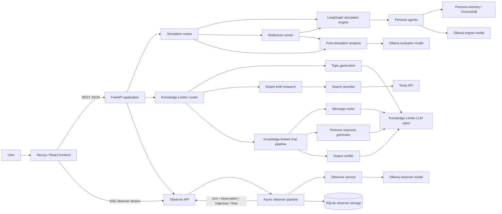
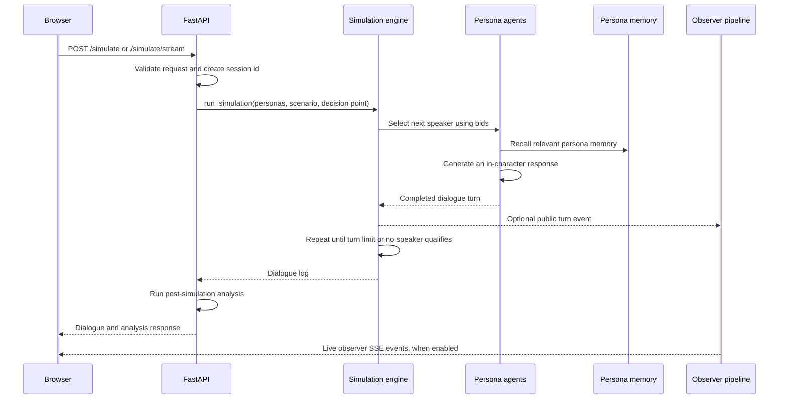
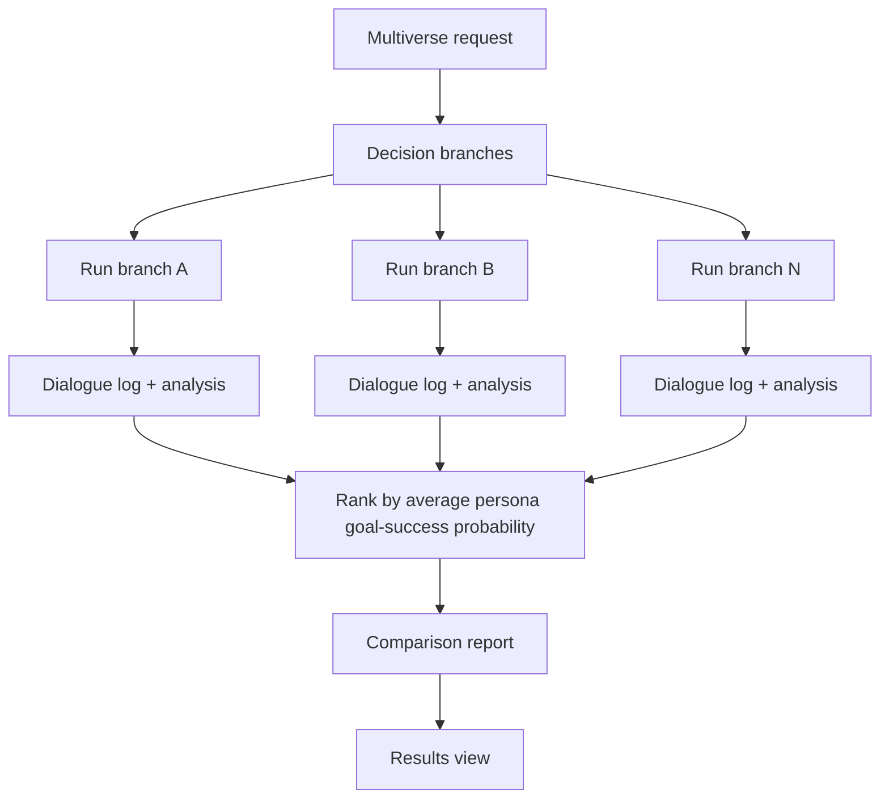
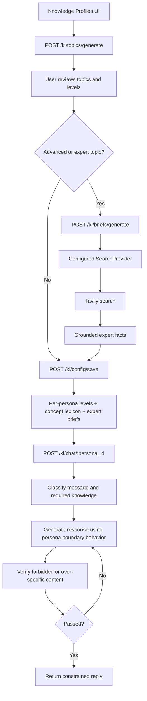
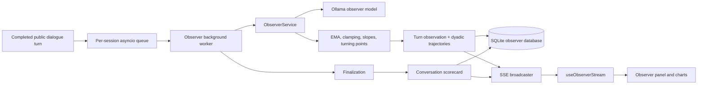
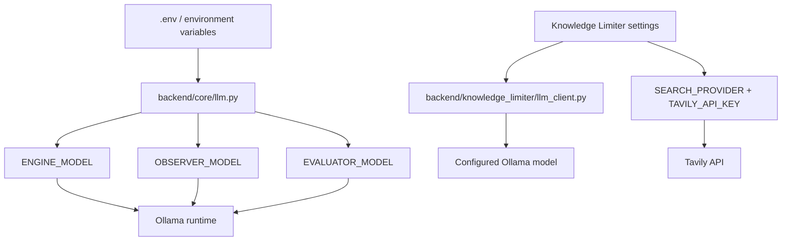

# Human Life Scenario Simulator — Project Architecture

This document describes the current high-level architecture of the Human Life Scenario Simulator (HLSS). The existing [`ARCHITECTURE.md`](ARCHITECTURE.md) contains the deeper design of the Knowledge Limiter module.

## System overview



## Runtime components

### Frontend

The frontend is a Next.js 14 application under [`frontend/`](frontend/). The main workflow is coordinated by [`frontend/src/app/page.tsx`](frontend/src/app/page.tsx):

1. **Character Builder** collects persona identity, traits, values, triggers, background, and goals.
2. **Scenario Setup** collects the scenario, decision point or branches, simulation mode, and tone.
3. **Knowledge Profiles & Boundaries** generates and reviews topic knowledge levels, optional expert briefs, and persona boundary behavior.
4. **Simulation screen** starts a single simulation or multiverse run and displays live progress.
5. **Results view** displays dialogue, observer scorecard, relationship trajectories, and comparison information.

Important frontend clients:

| Client | Responsibility |
|---|---|
| `src/lib/api.ts` | Simulation, multiverse, persona-building, health checks, and simulation SSE calls |
| `src/lib/knowledgeLimiterApi.ts` | Knowledge Limiter topic, research, and configuration calls |
| `src/lib/observerApi.ts` | Observer session creation, finalization, and SSE connection |
| `src/lib/useObserverStream.ts` | Converts observer SSE events into React state |

The frontend calls the FastAPI server directly. The default API URL is `http://localhost:8000`, or `NEXT_PUBLIC_API_URL` for Knowledge Limiter requests.

### FastAPI application

[`main.py`](main.py) creates the FastAPI application, configures CORS for the local Next.js development server, and mounts three route groups:

| Route group | Module | Purpose |
|---|---|---|
| Core simulator | `backend/api/routes.py` | Single runs, multiverse runs, streaming runs, and AI persona construction |
| Knowledge Limiter | `backend/knowledge_limiter/api/routes.py` | Topic generation, web-grounded briefs, config compilation, and constrained persona chat |
| Observer | `backend/observer/api.py` | Observer sessions, turn ingestion, SSE streams, trajectories, and scorecards |

Blocking simulation and LLM work is moved away from the FastAPI event loop using executor/background-worker mechanisms. A process-level simulation lock currently prevents overlapping core simulation runs.

## Single simulation flow



The simulation engine is implemented in [`backend/simulation/engine.py`](backend/simulation/engine.py). Each persona has an independent `PersonaAgent` and memory view. At each turn, eligible personas bid to speak; the highest scored bid becomes the next speaker. The engine then appends the completed response to the shared dialogue log.

## Multiverse flow



[`backend/simulation/multiverse.py`](backend/simulation/multiverse.py) runs each decision branch, collects its dialogue and analysis, and ranks branches by the average goal-success probability. The comparison output contains the ranked branches and the better/worse branch summaries.

## Knowledge Limiter flow



The Knowledge Limiter is a separate pipeline under [`backend/knowledge_limiter/`](backend/knowledge_limiter/). Its stages are:

- topic generation and persona-level assignment;
- optional expert brief research;
- configuration compilation into a lexicon and per-persona domain levels;
- message routing;
- persona response generation;
- deterministic and optional LLM output verification with bounded retries.

The search integration is provider-based. `SEARCH_PROVIDER=tavily` selects [`TavilySearchProvider`](backend/knowledge_limiter/research/search_provider.py), which reads `TAVILY_API_KEY` from the backend settings and sends the key only to Tavily’s search request.

## Observer flow



The Observer receives the public transcript only; it does not receive hidden persona prompts or private memory. Its asynchronous pipeline is implemented in [`backend/observer/pipeline.py`](backend/observer/pipeline.py), with analysis in [`backend/observer/core.py`](backend/observer/core.py) and persistence in [`backend/observer/storage.py`](backend/observer/storage.py).

Observer endpoints include:

- `POST /observer/sessions` — register a session and start its worker;
- `GET /observer/sessions/{id}/stream` — receive `turn`, `observation`, `trajectory`, `final`, and heartbeat events;
- `GET /observer/sessions/{id}/observations` — retrieve per-turn observations;
- `GET /observer/sessions/{id}/trajectory` — retrieve directed relationship trajectories;
- `GET /observer/sessions/{id}/scorecard` — retrieve the finalized scorecard;
- `POST /observer/sessions/{id}/finalize` — finalize analysis.

## LLM and external-service boundaries



The core simulation, observer, and evaluator model instances are created through [`backend/core/llm.py`](backend/core/llm.py). The Knowledge Limiter has its own `LLMClient` abstraction so its pipeline can keep model calls isolated from the core simulator.

## Persistence

| Store | Used by | Data |
|---|---|---|
| ChromaDB / persona memory | Core persona agents | Persona-specific recalled conversation memories |
| SQLite observer database | Observer pipeline | Sessions, observations, trajectories, and scorecards |
| In-memory session queues | Observer pipeline | Live events waiting for asynchronous processing and SSE delivery |

## Main source directories

```text
HLSS/
├── main.py                         FastAPI application entry point
├── backend/
│   ├── api/                         Core simulation REST/SSE routes and schemas
│   ├── agents/                      Core persona and legacy analysis models
│   ├── core/                        Shared core Ollama model factories
│   ├── simulation/                  LangGraph engine and multiverse runner
│   ├── memory/                      Persona memory adapter
│   ├── observer/                    Real-time observer service, pipeline, API, storage
│   └── knowledge_limiter/            Knowledge profiles, research, routing, generation, verification
├── frontend/
│   └── src/
│       ├── app/                     Main Next.js page and global theme
│       ├── components/              Setup, simulation, results, observer, and chart UI
│       └── lib/                     API clients, types, and observer stream hook
├── automation_bot/                  Browser automation helpers and tests
└── tests / test_*.py                 Backend and integration tests
```

## Development entry points

Backend:

```powershell
uvicorn main:app --reload --port 8000
```

Frontend:

```powershell
cd frontend
npm run dev
```

The frontend is normally available at `http://localhost:3000`, and the backend at `http://localhost:8000`.
